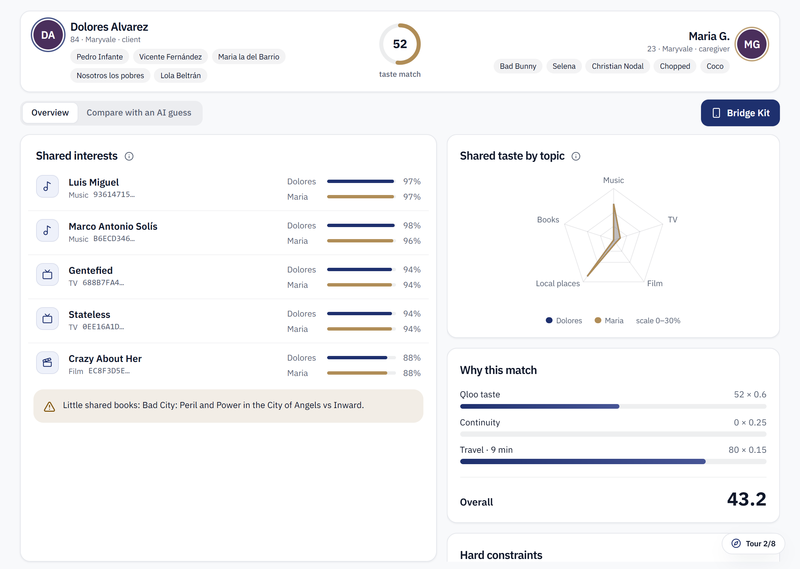
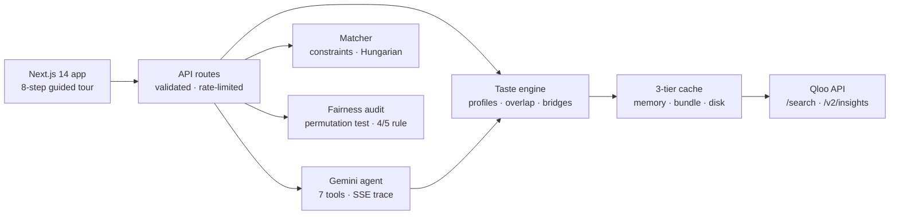

# Bonded

**Bonded matches home-care caregivers to elderly clients by what they both love, so the first visit feels like the tenth.**

An agent for home care agencies, grounded in Qloo's taste graph. It fills open schedules, covers last-minute call-outs, briefs every caregiver before the first visit, and warns the agency before a relationship falls apart.

**[Open the live app →](https://bonded-vivekyarra.vercel.app)** · Press **Guided tour** in the sidebar and use ← → to walk the full product in 8 steps.



- **94% separation** on a hand-labelled gold set of 20 pairs (ROC AUC), from live Qloo data ([evaluation](docs/evaluation.md))
- **2,400 caregiver-client pairs** scored across music, TV, film, local places and books
- **Every claim carries a Qloo entity ID.** The LLM never invents a song, show or place
- **0 server errors** across 36 hostile requests and concurrent load ([verification](docs/verification.md))

---

## The problem

Mrs. Alvarez is 84. This year she has opened her door to a different aide four times. None of them knew she cries at Pedro Infante films, so every visit started from zero.

Caregiver turnover is home care's number-one problem: median annual turnover has run at about **65%** ([HHCN, 2021](https://homehealthcarenews.com/2021/05/a-huge-victory-home-care-turnover-remains-stable-at-65-2/); [HCAOA, 2021](https://hcaoa.org/newsletters/caregiver-turnover-rate-is-652-2021-home-care-benchmarking-study)). Clients cancel when strangers keep showing up, and the riskiest moment is the substitute shift. Agencies match on zip code, availability and skills. Nobody matches on whether two people will enjoy four hours together, every week, for months.

**Bonded does.** Not just availability, but affinity.

## What it does

| | |
|---|---|
| **Fill every open schedule** | One click proposes the best qualified caregiver for each client, solved as an optimal assignment, with the shared tastes that make each pair click. The scheduler approves. |
| **See why two people click** | Dolores, 84, loves Pedro Infante and telenovelas. Maria, 23, loves Bad Bunny and cooking shows. Qloo finds their real common ground (Luis Miguel, Marco Antonio Solís, *Gentefied*), with both people's affinity for each. |
| **Cover a call-out in seconds** | Rosa can't make tomorrow's 9 am visit. The agent streams every step live: get the shift, filter on hard constraints, score with Qloo, rank, draft offers, then hold for human approval. |
| **Brief the caregiver** | Approve, and Maria's phone gets a **Bridge Kit**: three conversation openers, a shared playlist and something to do together, all from entities both people love. |
| **Catch a relationship going sour** | Visit notes and family ratings become early warnings with a better-matched caregiver suggested, before the client cancels. |
| **Prove it is fair** | Matching never sees race, ethnicity, religion or national origin. A built-in audit tests offer rates across self-reported groups. |
| **Try it yourself** | Type three favourites and meet your best match among 60 clients. |

## Why it only works with Qloo

An LLM can guess that two people "might both like music". Qloo **computes** taste overlap across domains and generations, from a graph of 250M+ entities. That is the whole product: without Qloo, matching falls back to age or ethnicity guesses, which are both wrong and illegal in employment. Taste is the defensible signal.

Bonded uses the Qloo API end to end:

1. **Resolve.** Every intake favourite goes through `GET /search` to a Qloo entity, with accent-insensitive exact matching and an 80 km radius for local places. 179 of 180 intake favourites resolve; anything else is reported, never guessed.
2. **Expand.** One `GET /v2/insights` call per domain (artist, TV, film, Phoenix places, books) builds each person's top-50 taste profile with affinity scores and explainability.
3. **Overlap.** A weighted Jaccard per domain, `Σ min(aff_C, aff_G) / Σ max(aff_C, aff_G)`, renormalised across the domains both people have, calibrated to 0–100.
4. **Bridges.** Shared entities ranked by `min(aff_C, aff_G)`, so a bridge must matter to *both* people. When a pair has too few, Bonded asks Qloo with the union of both people's favourites.
5. **Cache.** A three-tier cache (memory, deploy-time bundle, disk) with request coalescing, so 2,400 pair scores are instant and Qloo is called once per unique request.

**Head-to-head:** the same 20 labelled pairs are scored by Bonded and by an LLM reading raw favourites. Bonded separates compatible from incompatible pairs at **94%**, and every one of its bridges carries a Qloo ID and both people's affinity. The LLM's shared interests carry none, so they cannot be checked.

## The agent

A Google Gemini function-calling loop (`src/lib/agent/loop.ts`) with seven tools: `get_shift`, `find_available_caregivers`, `rank_candidates`, `score_pair`, `draft_offer`, `send_offer` and `qloo_search`. The trace streams to the UI over Server-Sent Events. If Gemini is busy, a deterministic runner with the same tools finishes the job, so a call-out is always covered.

Guardrails live in code, not just the prompt:

- **Closed-set Bridge Kit.** Every entity Gemini mentions must come from the pair's Qloo bridge list, or the kit is regenerated.
- **Human approval.** `send_offer` and `notify_family` refuse to run unless `approved_by_human === true`, which only the scheduler's approve button sets. The agent's tool schema cannot.
- **Protected-trait firewall.** The build fails if matching, scoring, Qloo or agent code imports audit demographics, or if intake gains race, ethnicity, religion or national-origin fields.

## Matching

1. **Hard constraints first:** availability, travel ≤ 45 min, skills, languages, pets, smoke, personal-care gender preference and weekly hour caps.
2. **Then rank** by `0.6 · taste + 0.25 · continuity + 0.15 · travel`, shown in every match's *Why this match* panel.
3. **Auto-match** solves a min-cost assignment (Hungarian algorithm) across all open schedules.
4. **Bonded proposes; the scheduler approves.**

## Architecture



**Stack:** Next.js 14 · TypeScript · Qloo Taste AI · Google Gemini · Tailwind CSS · Recharts · Vitest · Vercel

Details: [architecture](docs/architecture.md) · [ethics and fairness](docs/ethics.md) · [evaluation](docs/evaluation.md) · [verification](docs/verification.md)

## Product quality

- **Fits the screen.** Every guided-tour page fits a laptop window with no page scroll; long lists scroll in their own panel.
- **Light and dark.** White by default, with a theme switch saved per browser.
- **Readable for every age.** Plain-language labels, large targets, calm motion that respects `prefers-reduced-motion`.
- **Accessible.** axe-core WCAG 2 AA: 0 serious or critical issues on 9 pages, in both themes.
- **Tested.** 67 unit tests, plus lint, typecheck and a production build on every push.

## Run it locally

```bash
npm install
cp .env.example .env.local      # add QLOO_API_KEY and GEMINI_API_KEY
npm run qloo:smoke              # checks /search and /v2/insights against the live API
npm run dev                     # http://localhost:3000
```

| Variable | Required | Purpose |
|---|---|---|
| `QLOO_API_KEY` | yes | Qloo API key (server-side only) |
| `GEMINI_API_KEY` | recommended | Gemini orchestration, phrasing, note classification and the AI comparison ([get a key](https://aistudio.google.com/apikey)) |
| `GEMINI_MODEL` | no | defaults to `gemini-3.8-flash` |
| `QLOO_BASE_URL` | no | defaults to `https://hackathon.api.qloo.com` |

**Deploy on Vercel:** import the repo, add the two keys and deploy. `npm run vercel-build` warms the Qloo cache for up to 45 seconds, then builds; everything else is fetched and cached at runtime.

## What's next

- **Scheduling integrations:** sync shifts with the agency platforms schedulers already use.
- **Learning from every visit:** feed visit ratings back into the domain weights per agency.
- **Family app:** families add favourites and follow the relationship.
- **More domains:** food and dining from Qloo, for meal-time visits.

---

Built for the **Qloo Agentic Hackathon** · MIT licensed · *Bonded: every caregiver bonded, for real.*
